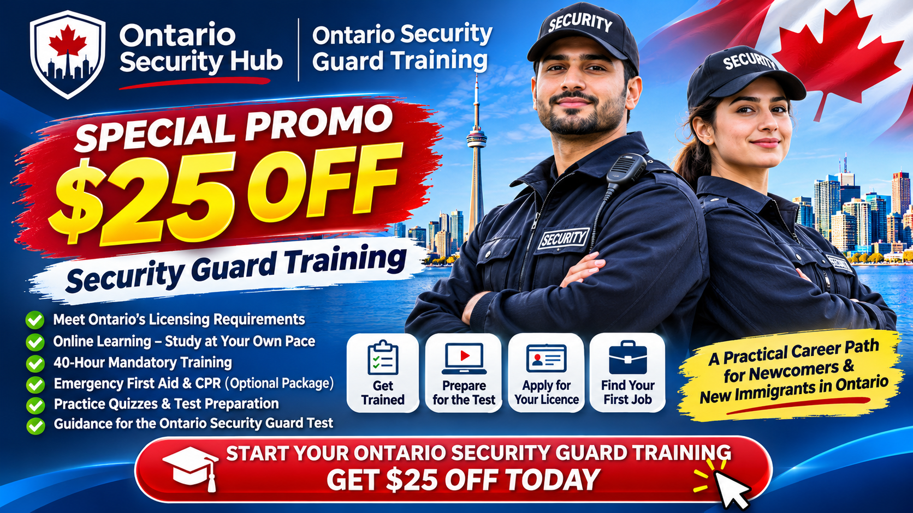

# 🛡️ Ontario Security Hub Promo Code – Get $25 OFF Security Guard Training (2026)

---

  <strong>Looking to start your first job as a security guard in Ontario?</strong>
   
  Whether you're a newcomer, a new immigrant, or someone looking for a career change, learn how to get licensed and start your security career in Ontario.

  

  🎉 <strong><a href="https://ontariosecurityhub.ca/training/login/signup.php?source=securityguard">CLAIM YOUR $25 OFF ONTARIO SECURITY GUARD TRAINING</a></strong>

Learn how to get your Ontario security guard licence, complete the required training, prepare for the ministry test, and find your first security job.

---

## 📑 Table of Contents

1. [Why Consider a Security Guard Job in Ontario?](#why-consider-a-security-guard-job-in-ontario)
2. [Who Can Become a Security Guard in Ontario?](#who-can-become-a-security-guard-in-ontario)
3. [Step-by-Step Guide to Becoming a Licensed Security Guard](#step-by-step-guide-to-becoming-a-licensed-security-guard)
4. [Ontario Security Guard Training – What Will You Learn?](#ontario-security-guard-training--what-will-you-learn)
5. [How to Pass the Ontario Security Guard Test](#how-to-pass-the-ontario-security-guard-test)
6. [How to Apply for Your Ontario Security Guard Licence](#how-to-apply-for-your-ontario-security-guard-licence)
7. [How Much Does It Cost to Become a Security Guard?](#how-much-does-it-cost-to-become-a-security-guard)
8. [How to Find Your First Security Guard Job](#how-to-find-your-first-security-guard-job)
9. [Security Guard Resume Tips for Newcomers](#security-guard-resume-tips-for-newcomers)
10. [Common Security Guard Interview Questions](#common-security-guard-interview-questions)
11. [Types of Security Guard Jobs in Ontario](#types-of-security-guard-jobs-in-ontario)
12. [Tips for Succeeding in Your First Security Job](#tips-for-succeeding-in-your-first-security-job)
13. [Frequently Asked Questions](#frequently-asked-questions)
14. [Get $25 OFF Your Security Guard Training](#get-25-off-your-security-guard-training)
15. [Useful Official Resources](#useful-official-resources)
16. [Final Thoughts](#final-thoughts)
17. [Affiliate Disclosure](#affiliate-disclosure)

---

## Why Consider a Security Guard Job in Ontario?

Moving to a new country or starting a career in a new province can be challenging. Many newcomers and new immigrants arrive in Ontario with education, professional experience, and valuable skills but may need time to establish themselves in the Canadian job market.

A security guard position can be one potential starting point.

Ontario has security positions across different industries, including:

- Office buildings and commercial properties
- Condominiums and residential communities
- Shopping malls and retail stores
- Hospitals and healthcare facilities
- Warehouses and industrial facilities
- Construction sites
- Educational institutions
- Events and entertainment venues
- Hotels and hospitality properties

Depending on the employer and position, security work may offer full-time, part-time, overnight, weekend, or rotating shifts.

### Why Security Work May Be a Good Starting Point

**1. A Regulated Entry Path**

Ontario has a defined licensing process. Once you meet the eligibility requirements, complete the required training, pass the test, and obtain your licence, you can apply for security guard positions.

**2. Opportunities Across Different Industries**

You aren't limited to one type of workplace. You can explore opportunities in residential buildings, corporate offices, retail, healthcare, industrial properties, and more.

**3. Develop Canadian Workplace Experience**

A security position can help you become familiar with Canadian workplace expectations, professional communication, customer service, safety procedures, and incident reporting.

**4. Build Transferable Skills**

Security work can help you develop skills that may also be useful in other careers, including building operations, property management, customer service, health and safety, and facility management.

**5. Potential Career Progression**

With experience and additional qualifications, you may explore opportunities such as security supervisor, site supervisor, operations coordinator, or security management.

Your career progression will depend on your experience, qualifications, employer requirements, and available opportunities.

---

## Who Can Become a Security Guard in Ontario?

Before spending money on training, make sure you understand Ontario's eligibility requirements.

According to the Ontario government, applicants must:

- Be at least 18 years old.
- Be legally entitled to work in Canada.
- Have a clean criminal record under Ontario's licensing rules.
- Have a valid Criminal Record and Judicial Matters Check (CRJMC).
- Complete the mandatory security guard training.
- Pass the Ontario security guard licensing test.

### Can New Immigrants Become Security Guards?

Yes, newcomers and immigrants can apply if they meet the licensing requirements.

Your immigration status and authorization to work in Canada matter.

Examples of people who may qualify include:

- Canadian citizens
- Permanent residents
- Individuals with valid work authorization

Having a visitor visa alone does not give you permission to work in Canada.

If you are an international student or temporary resident, check the conditions of your immigration status and work authorization before accepting employment.

### Do You Need Canadian Work Experience?

You do not need previous Canadian security work experience just to complete the basic licensing process.

However, individual employers may have their own hiring requirements. Some entry-level positions may accept applicants without previous security experience, while other positions may prefer candidates with relevant experience.

Good communication, professionalism, reliability, and report-writing skills can help when applying for your first position.

---

## Step-by-Step Guide to Becoming a Licensed Security Guard

Here is the general process to follow if you want to start working as a security guard in Ontario.

### Step 1: Check Your Eligibility

Before enrolling in a training program, make sure you:

- Are at least 18 years old.
- Are legally entitled to work in Canada.
- Meet the criminal record requirements.
- Can obtain the required Criminal Record and Judicial Matters Check.

If you are unsure about a past criminal record or an immigration-related eligibility question, review the official Ontario requirements before paying for training.

### Step 2: Complete the Mandatory 40-Hour Security Guard Training

Ontario requires new security guard applicants to complete an approved basic training program.

The basic security guard training program must be at least 40 hours, including the required Emergency First Aid and CPR certification.

You can explore online training options that allow you to study at your own pace.

One option is Ontario Security Hub, which advertises online lessons, videos, quizzes, and practical scenarios based on the ministry-required training syllabus.

**Explore the training and claim the promotional discount:**

[Ontario Security Hub – Register for Security Guard Training](https://ontariosecurityhub.ca/training/login/signup.php?source=securityguard)

### Step 3: Complete Emergency First Aid and CPR

Emergency First Aid and CPR certification is an important part of the Ontario security guard training requirement.

Make sure your certificate meets the applicable requirements.

If you already have a valid qualifying certificate, check with your training provider before purchasing another course.

Not every online-only first aid certificate is accepted for this purpose. Confirm that the provider and certification meet the applicable WSIB requirements.

### Step 4: Receive Your Training Completion Number

After successfully completing the required training and first aid requirements, your training provider will issue a Training Completion Number (TCN).

You need this number to register for the Ontario security guard licensing test.

### Step 5: Pass the Ontario Security Guard Test

Register for the ministry test through the official testing provider.

The test consists of:

- 60 multiple-choice questions
- 75 minutes to complete
- Questions based on the required training material

You can take the test online or at participating DriveTest centres.

Prepare properly before booking your test.

### Step 6: Obtain Your Criminal Record and Judicial Matters Check

You will need a valid Criminal Record and Judicial Matters Check for your security guard licence application.

Make sure you obtain the correct type of check and follow the current application instructions.

A basic employment criminal record check is not necessarily the same document.

### Step 7: Apply for Your Ontario Security Guard Licence

Once you have completed the training, passed the test, and obtained the required documents, you can apply for your Ontario security guard licence.

After your licence is approved, you can start applying for eligible security guard positions.

**Important:** You must have a valid Ontario security guard licence before performing paid security guard duties.

---

## Ontario Security Guard Training – What Will You Learn?

The mandatory training is designed to prepare you for the responsibilities and legal requirements of working in the security industry.

The Ontario security guard training syllabus covers topics such as:

| Training Topic | What You Will Learn |
|---|---|
| Introduction to the Security Industry | The role and responsibilities of security guards |
| Private Security and Investigative Services Act | Ontario's security industry legislation and regulations |
| Basic Security Procedures | Patrols, access control, and general security duties |
| Report Writing | How to prepare clear and professional incident reports |
| Health and Safety | Workplace safety and hazard awareness |
| Emergency Response Preparation | How to respond to emergencies |
| Canadian Legal System | Basic knowledge of Canadian law |
| Legal Authorities | Understanding legal powers and limitations |
| Effective Communications | Professional communication and conflict management |
| Sensitivity Training | Respectful interaction with different people and communities |
| Use of Force Theory | Understanding lawful and appropriate use-of-force principles |
| Emergency First Aid and CPR | Basic emergency response and lifesaving skills |

### Why Is Report Writing Important?

One of the most important skills for a security guard is writing professional reports.

During your shift, you may need to document:

- Visitors and access-control issues
- Property damage
- Suspicious activity
- Medical emergencies
- Fire alarms
- Safety hazards
- Complaints and disturbances
- Security incidents

Your reports should be factual, clear, objective, and professional.

Avoid assumptions, emotional language, and unnecessary personal opinions.

### Why Communication Skills Matter

Security guards regularly interact with residents, employees, visitors, contractors, management, emergency responders, and members of the public.

Good communication can help you:

- Give clear instructions.
- Handle complaints professionally.
- De-escalate difficult situations.
- Explain building procedures.
- Communicate with emergency services.
- Maintain accurate records.

For newcomers, improving professional English communication can be especially helpful when entering the security industry.

---

## How to Pass the Ontario Security Guard Test

Passing the ministry test is an important milestone in obtaining your Ontario security guard licence.

The test contains 60 multiple-choice questions, and you have 75 minutes to complete it.

### How to Prepare

**1. Study the Entire Training Material**

Don't focus only on practice questions. Understand the concepts, legal responsibilities, procedures, and examples covered in your training.

**2. Pay Special Attention to Legal Authorities**

Understand what security guards are legally allowed to do and what falls outside their authority.

**3. Practise Report Writing Concepts**

Learn how to identify relevant facts and prepare objective incident reports.

**4. Review Emergency Procedures**

Understand basic responses to fire alarms, medical emergencies, suspicious packages, and other incidents.

**5. Use Practice Questions**

Practice quizzes can help you identify weak areas and become familiar with multiple-choice questions.

**6. Avoid Memorizing Answers Without Understanding Them**

The goal is to understand how to apply the information in real situations, not simply memorize a set of answers.

### Test Preparation With Ontario Security Hub

Ontario Security Hub advertises:

- More than 80 video lessons
- Over 110 quiz questions
- 300 practice test questions
- Assignments for different training sections
- Access to course material at any time
- Test booking assistance

Check the current course details to confirm the materials and services included in your selected package.

---

## How to Apply for Your Ontario Security Guard Licence

After passing the test, you can apply for your individual security guard licence through the Ontario government.

### Documents and Information You May Need

Prepare the required documents before starting your application.

These may include:

- Your security guard training information and test completion details
- Your valid Criminal Record and Judicial Matters Check
- Two acceptable government-issued identification documents
- Proof that you are legally entitled to work in Canada
- Your personal information and contact details
- The required licence application payment

For example, depending on your status and the current accepted-document list, a Permanent Resident Card, Confirmation of Permanent Residence, or valid work permit may help establish work eligibility.

Check the current Ontario identification requirements before submitting your application.

### How Long Does Licence Approval Take?

Ontario indicates that a correctly completed online application can take up to 15 calendar days to process.

Incomplete applications or missing documents may cause delays.

### Is the Licence Digital?

Yes. Ontario issues security guard licences digitally.

You must carry a digital or printed copy of your valid licence and be prepared to show it when requested.

A security guard licence is generally valid for two years, with its expiry date linked to your date of birth.

Always check the expiry date and renew your licence before it expires.

---

## How Much Does It Cost to Become a Security Guard?

Before starting, it's helpful to understand the different costs involved.

Ontario Security Hub currently advertises two training options on its website:

| Training Option | Advertised Price |
|---|---:|
| Security Guard Course Including Emergency First Aid and CPR/AED Level C | $199 CAD + HST |
| Security Guard Course Without First Aid and CPR | $119 CAD + HST |

The second option is intended for people who already have a qualifying certificate or plan to complete first aid separately.

Other expenses may include:

| Expense | Advertised or Applicable Cost |
|---|---:|
| Ministry licensing test | Check current testing provider fee |
| Ontario security guard licence | Check current Ontario government fee |
| Criminal Record and Judicial Matters Check | Varies by police service and application method |
| Additional first aid training | Depends on provider and course |

Prices and government fees can change. Confirm the current amount before making a payment.

### Can You Save Money on Training?

Yes. You can use the Ontario Security Hub promotional registration link below to access the advertised $25 OFF offer.

[**Get $25 OFF Ontario Security Guard Training**](https://ontariosecurityhub.ca/training/login/signup.php?source=securityguard)

---

## How to Find Your First Security Guard Job

Once you receive your Ontario security guard licence, the next step is finding an employer.

For newcomers and people without previous Canadian security experience, the first job search can feel challenging.

The good news is that there are different types of entry-level security positions to explore.

### 1. Prepare a Canadian-Style Resume

Create a professional one- or two-page resume highlighting:

- Your Ontario security guard licence
- First Aid and CPR certification
- Relevant employment history
- Customer service experience
- Communication skills
- Report-writing abilities
- Computer skills
- Availability for shifts

If you worked in another country, include relevant experience. International work experience can still demonstrate valuable skills.

### 2. Apply to Security Companies

Consider applying directly to security companies operating in Ontario.

Examples of companies to research include:

- Paragon Security
- GardaWorld
- Paladin Security
- Securitas
- Commissionaires
- Allied Universal

Visit their official career pages and check their current job requirements.

These are examples of employers to research, not guarantees of current vacancies or hiring.

### 3. Search Job Websites

Use job search platforms to find security guard vacancies.

Useful resources include:

- [Government of Canada Job Bank](https://www.jobbank.gc.ca/)
- [Indeed Canada](https://ca.indeed.com/)
- [LinkedIn Jobs](https://www.linkedin.com/jobs/)
- [Google Jobs](https://www.google.com/search?q=security+guard+jobs+Ontario)

### 4. Search Using Different Job Titles

Don't search only for "Security Guard."

Try these terms:

- Security Guard
- Security Officer
- Concierge Security
- Residential Security Guard
- Mobile Patrol Guard
- Loss Prevention Officer
- Access Control Officer
- Security Site Guard
- Corporate Security Guard
- Overnight Security Guard

Always read the job description carefully and confirm that you meet the employer's requirements.

### 5. Be Flexible With Your First Position

Your first security job may not be your ideal position.

You may want to consider different sites, shifts, and work environments to gain experience.

Once you have Canadian security experience, you can explore other opportunities that better match your interests and career goals.

---

## Security Guard Resume Tips for Newcomers

If you recently arrived in Canada, you may be wondering how to present your international experience.

The important thing is to highlight skills that are relevant to security work.

### Include These Skills in Your Resume

- Customer service
- Verbal and written communication
- Conflict resolution
- Attention to detail
- Observation and monitoring
- Incident reporting
- Emergency response awareness
- Access control
- Teamwork
- Professionalism
- Reliability and punctuality

Only include skills you genuinely possess.

### Example of a Professional Resume Summary

You can adapt the following example to your own experience:

"Reliable and professional entry-level security guard with an Ontario Security Guard Licence and valid First Aid and CPR certification. Strong communication, customer service, observation, and problem-solving skills. Able to follow security procedures, prepare accurate incident reports, and maintain a safe and welcoming environment. Seeking an opportunity to contribute to a professional security team."

### Should You Include International Work Experience?

Absolutely.

For example:

- Customer service experience demonstrates your ability to communicate with people.
- Retail experience demonstrates customer interaction and loss-prevention awareness.
- Warehouse experience demonstrates safety awareness and attention to procedures.
- Administrative experience demonstrates documentation and computer skills.
- Military or law enforcement experience may provide relevant experience, subject to the employer's requirements.

You do not need to hide your international employment history.

Present it clearly and focus on the skills relevant to the position.

---

## Common Security Guard Interview Questions

Preparing for an interview can help you feel more confident, especially if this is your first job in Canada.

Here are some questions you may encounter.

### 1. Tell Me About Yourself.

Give a short introduction about your background, relevant experience, qualifications, and interest in security work.

### 2. Why Do You Want to Become a Security Guard?

Explain that you are interested in maintaining a safe environment, helping people, following procedures, and taking responsibility.

### 3. What Would You Do If You Saw Someone Acting Suspiciously?

Explain that you would observe the situation, follow site procedures, maintain safety, communicate with your supervisor, and document relevant facts.

### 4. How Would You Handle an Angry Visitor?

Explain that you would remain calm, communicate respectfully, listen to the person's concerns, avoid unnecessary confrontation, and follow the site's escalation procedures.

### 5. What Would You Do During a Fire Alarm?

Explain that you would follow the emergency response plan, notify the appropriate personnel, assist with evacuation as instructed, and avoid putting yourself or others in danger.

### 6. How Would You Handle a Medical Emergency?

Explain that you would follow emergency procedures, call 911 when appropriate, provide assistance within your training, and notify your supervisor.

### 7. Are You Comfortable Working Overnight or Weekends?

Answer honestly based on your actual availability.

### Interview Tip

Employers often look for reliability, professionalism, communication, good judgment, and the ability to follow instructions.

You don't need to pretend to know everything. Show that you are willing to learn and understand the importance of following company procedures.

---

## Types of Security Guard Jobs in Ontario

There are different environments in which security guards may work.

Understanding these options can help you decide which positions to target.

### 1. Residential and Condominium Security

Typical responsibilities may include:

- Monitoring building entrances
- Visitor registration
- Access control
- Monitoring security cameras
- Responding to resident concerns
- Conducting property patrols
- Preparing incident reports

This type of position may involve customer service and concierge responsibilities.

### 2. Commercial Building Security

Security guards may work in office towers and commercial properties.

Responsibilities can include:

- Monitoring access points
- Managing visitor access
- Conducting patrols
- Monitoring CCTV systems
- Responding to alarms
- Maintaining daily activity reports

### 3. Retail Security and Loss Prevention

Retail security positions may involve:

- Monitoring store premises
- Deterring theft
- Observing suspicious activity
- Assisting with incident documentation
- Supporting store safety procedures

Some loss-prevention positions may require additional employer-specific training or experience.

### 4. Hospital Security

Hospital security guards help maintain a safe environment for patients, visitors, and staff.

The role may involve:

- Monitoring entrances
- Responding to security calls
- Assisting with visitor management
- Conducting patrols
- Supporting emergency response procedures

Employers may require additional qualifications or specialized experience.

### 5. Mobile Patrol Security

Mobile patrol guards travel between different properties or locations.

Responsibilities may include:

- Conducting scheduled patrols
- Checking doors and access points
- Responding to alarms
- Reporting property issues
- Documenting site visits

A valid driver's licence may be required for many mobile patrol positions.

### 6. Construction Site Security

Construction security guards may be responsible for:

- Monitoring site access
- Checking visitor authorization
- Conducting perimeter patrols
- Reporting suspicious activity
- Monitoring equipment and materials

The employer may require additional site-specific safety training.

---

## Tips for Succeeding in Your First Security Job

Getting hired is only the beginning. Building a good reputation at your first security job can help you develop professionally.

Here are some practical tips.

### Be Punctual

Arrive early enough to receive your shift briefing and understand any instructions from the outgoing guard.

### Learn the Site Procedures

Every property has different rules, emergency procedures, access requirements, and reporting expectations.

Learn them carefully.

### Write Professional Reports

Keep reports factual, objective, and detailed.

Include relevant times, locations, observations, actions taken, and notifications made.

### Maintain Professional Communication

You may interact with residents, employees, visitors, contractors, and management.

Always remain respectful and professional.

### Avoid Unnecessary Confrontations

Your responsibility is to follow the law, your training, and site procedures.

Do not take unnecessary risks or act outside your legal authority.

### Take Your Responsibilities Seriously

Even routine tasks such as checking doors, monitoring cameras, and recording visitor information can be important.

### Keep Learning

Look for opportunities to develop additional skills in:

- Emergency response
- Customer service
- Building systems
- Fire safety
- CCTV monitoring
- Access control
- Report writing
- Health and safety

These skills may help you explore future career opportunities.

---

## Frequently Asked Questions

### 1. How long does it take to become a security guard in Ontario?

The mandatory basic training is at least 40 hours, including the required Emergency First Aid and CPR certification. You must also pass the ministry test, obtain the required background check, and apply for your licence. Your overall timeline depends on how quickly you complete each step.

### 2. Can newcomers or immigrants become security guards in Ontario?

Yes. Newcomers can qualify if they meet the age, work authorization, criminal record, training, testing, and other licensing requirements.

### 3. Can I work as a security guard without a licence?

No. You must have a valid Ontario security guard licence before performing paid security guard duties.

### 4. Is the security guard training mandatory?

Yes. New applicants must complete the required basic training and pass the ministry test before applying for their licence.

### 5. Is First Aid and CPR required?

Yes. The required security guard basic training includes Emergency First Aid and CPR certification. Make sure your certificate meets the applicable requirements.

### 6. Is the Ontario security guard test difficult?

The test covers the material taught in the required training. Studying the course material and completing practice questions can help you prepare.

### 7. Can I complete security guard training online?

Online training is available through providers that meet Ontario's training requirements. Confirm that the provider is eligible to deliver the required training.

### 8. How many questions are on the Ontario security guard test?

The ministry test contains 60 multiple-choice questions, with 75 minutes to complete it.

### 9. How long does it take to receive the Ontario security guard licence?

Ontario indicates that a correctly completed online licence application can take up to 15 calendar days to process. Missing documents may cause delays.

### 10. How much does an Ontario security guard licence cost?

Check the current Ontario government licence fee before applying. Training, testing, background checks, and first aid may involve separate costs.

### 11. Can international students become security guards?

Potentially, yes, if they meet the licensing requirements and their immigration status permits the employment. Check your study permit conditions and current work authorization rules before accepting a position.

### 12. Does Ontario Security Hub provide practice tests?

Ontario Security Hub advertises practice questions, quizzes, video lessons, and test preparation materials. Check the current package for the included resources.

### 13. Can I get a discount on Ontario Security Hub training?

You can use the promotional registration link below to access the advertised $25 OFF offer.

[Claim the Ontario Security Hub $25 OFF Promotion](https://ontariosecurityhub.ca/training/login/signup.php?source=securityguard)

### 14. Does completing the course guarantee a security guard job?

No. Training prepares you for the licensing process, but you must also pass the test, obtain your licence, and successfully apply for employment. Hiring decisions depend on individual employers.

---

## Get $25 OFF Your Security Guard Training

If you are ready to begin your journey toward becoming a licensed security guard in Ontario, Ontario Security Hub is one training provider you can explore.

Its advertised online program includes video lessons, quizzes, and real-world scenarios designed to help students understand the security industry and prepare for the Ontario licensing test.

### What You Can Explore

- Online security guard training
- Ministry-required training topics
- Video lessons and learning materials
- Practice quizzes and test preparation
- Emergency First Aid and CPR training options
- Access to instructors for questions
- Assistance with the licensing test process

### Claim Your $25 Discount

Use the promotional link below to register and check the discount available to you.

🎓 **[REGISTER WITH ONTARIO SECURITY HUB – SAVE $25](https://ontariosecurityhub.ca/training/login/signup.php?source=securityguard)**

Before purchasing, review the available training packages, eligibility requirements, course details, refund terms, and final checkout price.

---

## Useful Official Resources

For the most accurate and up-to-date information, always refer to the Ontario government and official licensing resources.

| Resource | What You Can Find |
|---|---|
| [Ontario Security Guard Training](https://www.ontario.ca/page/security-guard-and-private-investigator-basic-training) | Mandatory training requirements and course information |
| [Ontario Security Guard Testing](https://www.ontario.ca/page/security-guard-and-private-investigator-testing) | Test format, registration, and testing instructions |
| [Security Guard Licence Application](https://www.ontario.ca/page/security-guard-or-private-investigator-licence-individuals) | Eligibility, required documents, and licence application |
| [Security Guard Training Providers](https://www.ontario.ca/page/security-guard-and-private-investigator-basic-training-providers) | Information about eligible training providers |
| [Security Guard Training Syllabus](https://www.ontario.ca/document/training-syllabus-security-guards) | Official training topics |
| [Government of Canada Job Bank](https://www.jobbank.gc.ca/) | Search for security guard employment opportunities |

---

## Final Thoughts

Starting a new career in Canada can feel overwhelming, particularly when you are unfamiliar with local licensing requirements and hiring practices.

Becoming a security guard in Ontario offers a structured entry path: check your eligibility, complete the mandatory training, obtain your first aid certification, pass the ministry test, apply for your licence, and begin searching for employment.

For newcomers and people looking to establish their first Canadian work experience, the security industry may provide an opportunity to develop professional skills, understand Canadian workplace expectations, and explore different career paths.

The most important thing is to start with the right information, choose an eligible training provider, prepare properly for your test, and obtain your licence before working.

If you're ready to take the first step, explore Ontario Security Hub and check the $25 promotional offer.

🎯 **[START YOUR ONTARIO SECURITY GUARD JOURNEY – GET $25 OFF](https://ontariosecurityhub.ca/training/login/signup.php?source=securityguard)**

---

## Affiliate Disclosure

This article contains a promotional referral link to Ontario Security Hub. If you register through the link and make a qualifying purchase, I may receive a referral benefit or commission at no additional cost to you.

The purpose of this guide is to help newcomers, immigrants, and other job seekers understand the process of becoming a security guard in Ontario.

Training prices, promotional discounts, licensing fees, eligibility requirements, and course details may change. Always confirm the latest information with Ontario Security Hub and the Ontario government before making a payment or submitting an application.
